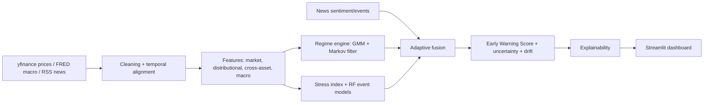

# Adaptive Multimodal Real-Time Market Regime Intelligence & Early-Warning System

> This system is for research and educational purposes only. It does not provide financial advice, investment recommendations, or guaranteed predictions.

## Problem / motivation / gap
Price-prediction dashboards ignore regime structure, cross-market stress and data reliability. This project integrates regime detection, stress estimation, multi-horizon early warning, uncertainty, drift detection and explainability in one CPU-only, free-to-run Streamlit app. **Novelty is in system integration (dynamic modality reliability weighting + regime + warning + XAI), not in any single technique.**

## Architecture


## Research alignment
| Component | Research concept | Implementation |
|---|---|---|
| Temporal alignment | asynchronous multimodal fusion | publication-lag shifted macro, causal ffill, news stamped <= now |
| Adaptive fusion | modality reliability | prior x availability x salience weights (heuristic) |
| Regime detection | HMM / particle filtering | GMM states + empirical Markov matrix + Bayesian forward filter |
| Distributional features | multi-scale shape descriptors | vol, skew, kurtosis, CVaR, tail frequency, drawdown |
| Early warning | spillover + ML | correlation-concentration, network, RF forward-drawdown models |
| Uncertainty | probabilistic prediction | across-tree std, regime entropy, drift penalty |
| Explainability | XAI | SHAP (optional) else importance x z-score; modality grouping |

## Run locally
```
pip install -r requirements.txt
streamlit run app.py
python -m tests.test_pipeline   # offline synthetic plumbing test
```
## Deploy (Streamlit Community Cloud)
Push this folder to GitHub -> share.streamlit.io -> New app -> main file `app.py`. Add `shap` to requirements only if install time is acceptable.

## Methodology and leakage control
- All rolling features are backward-looking; percentile ranks use only prior observations.
- FRED series are shifted by a publication lag; news items dated in the future are dropped.
- Event labels look h days ahead, so training/walk-forward purges the last h rows before each cut.
- Backtests use expanding-window walk-forward only.

## Limitations (honest)
- Regime GMM is fit on the full window (in-sample); names are assigned by risk ordering - inspect the profile table.
- Free price data is delayed, never "LIVE". News is headline-only, lexicon-based, no history, not validated.
- Credit spread history on FRED may be short; it is used only in the live macro score.
- XGBoost, LSTM/GRU, Transformer, intraday data, liquidity proxy and dot-com coverage are not implemented.
- Warning probabilities may be uncalibrated; check the calibration plot. Nothing here is validated until you run the Backtest tab.

## Future work
Pretrained/saved models, learned gating network, Diebold-Yilmaz spillover, FinBERT (if size allows), conformal calibration.
